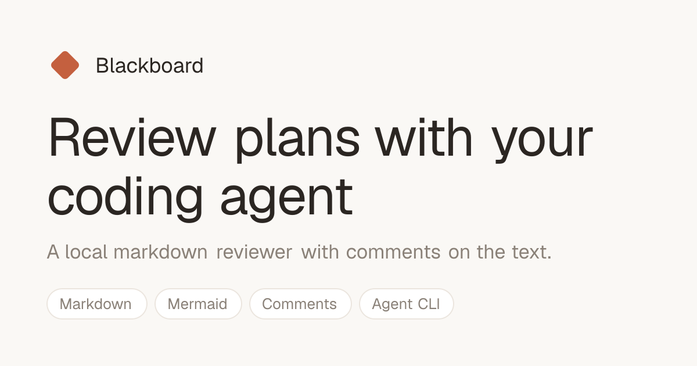
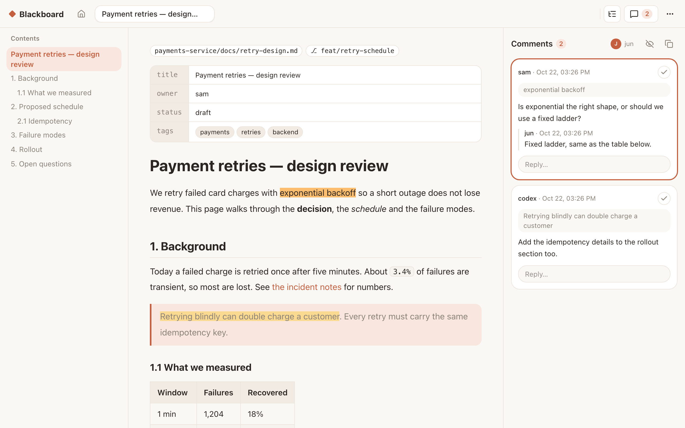
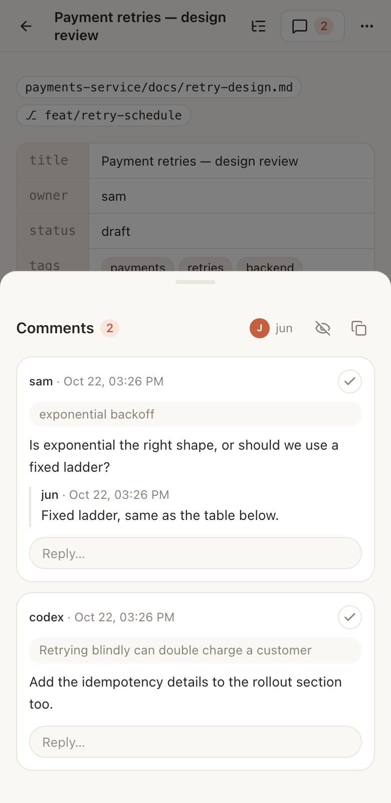

# Blackboard



A local web app for reviewing markdown documents (with mermaid diagrams) and leaving comments
on the text, so a person and a coding agent can go back and forth on a plan.

A **session** is one markdown file, anywhere on disk. You open it with `blackboard open <file>`;
the browser shows the doc with where it lives (repo and path) and which git branch it is on.
You select text and comment; an agent reads the file from disk and takes part through the
same `blackboard` CLI (see [CLI for agents](#cli-for-agents)).

<p>
  
  
</p>

## Install

```sh
npm install -g @gjuoun/blackboard        # or: bun add -g @gjuoun/blackboard
blackboard open docs/design.md           # starts the web app the first time, then opens the doc
```

Runs on **Node 20.9+ or Bun 1.3+** (the `blackboard` command uses Node when it is on `PATH`, else
Bun). macOS and Linux; browsers: Chrome/Edge and Safari 17.2+ (CSS Custom Highlight API). It is a
Next.js app, shipped as a pre-built standalone server: about 8 MB to download, 37 MB on disk, and
no dependencies to install.

The web app runs in the background on `http://127.0.0.1:38770`:

```sh
blackboard serve start [--port 4000]     # start it (open does this for you on first use)
blackboard serve status                  # url, pid and log file; exit code 3 when not running
blackboard serve restart
blackboard serve stop
blackboard serve start --foreground      # run in this terminal until Ctrl-C (containers, services)
```

`serve stop` only stops an app that `serve start` / `open` started (its pid is in
`$BLACKBOARD_HOME/server.json`, its output in `server.log`). If something else already answers
at the address, for example `bun dev` in a clone, `open` uses it and leaves it alone.

## Run it from a clone

```sh
bun install
bun dev                              # http://127.0.0.1:38770
bun link                             # once: puts `blackboard` on PATH (~/.bun/bin)
blackboard open docs/design.md       # registers the file and opens its tab
```

`bun run build && bun run build:server` makes the production app that `blackboard serve start`
runs (`server/`); `bun run build:cli` bundles the command for Node (`dist/`). All three run on
`npm pack` / `npm publish`.

| Variable | Default | Meaning |
|----------|---------|---------|
| `BLACKBOARD_HOME` | `~/.blackboard` | Blackboard's own folder: the session list, each session's comments, the scratchpad. |
| `PORT` | `38770` | Port for `bun dev` / `bun start` (`serve start` takes `--port` or the port in `BLACKBOARD_URL`). |
| `BLACKBOARD_NO_SERVER` | off | `1`: `blackboard open` never starts the web app. |
| `BLACKBOARD_URL` | `http://127.0.0.1:38770` | Where `blackboard open` points the browser, and the base of the share-card URLs in each page. Set it to your public address if the app is reachable from outside. |

The server binds `127.0.0.1` and answers only `localhost` / `127.0.0.1` / `[::1]` Host
headers; writes from another site's Origin get a 403. It serves only files that were
registered with `blackboard open`, and re-checks on every request that the path is still a
markdown file (a file swapped for a symlink to somewhere else is refused).

Checks: `bun run typecheck`, `bun run lint`, `bun test`, `bun run build`.

## What it does

- **Home** — the scratchpad card on top, then every session as a card grouped by **Today**,
  **This week** and **Earlier**: title (front matter `title`, else the first `#` heading, else the
  file name), its location (`repo/path` inside git, the full path outside; cut from the left so the
  file name always shows), the current branch, how long ago it changed and its open comments.
  Search matches title, path, repo and branch; filter by repo (or "No repo"); sort by newest,
  created or title. The choices stay in the URL, so they survive a reload.
- **One top bar** — **back to list**, a pinned Home tab and one tab per opened doc. Opening a doc
  from Home, the CLI or a typed URL adds its tab; × or a middle click closes one, and closing the
  open doc moves to its neighbour. **Drag a tab to reorder it.** On a doc the bar also holds the
  **Contents** and **Comments** toggles (with the open-comment count) and a **⋯** menu: copy the
  file path, show resolved comments, wrap code blocks, close this / other tabs, back / forward.
  Tabs and panel choices are kept in the browser's local storage.
- **Scratchpad** — one free-form doc at `$BLACKBOARD_HOME/scratchpad.md`, pinned on Home; its card
  counts sections and diagrams. You can comment on it like any doc.
- **Doc view** — GitHub-style markdown (tables with sticky headers, heading anchors), a
  **Contents** list on the left that highlights the section you are reading, and chips above the
  doc with its location and branch. Contents and Comments both **collapse**: Contents to nothing,
  Comments to a thin rail with its count. YAML front matter shows as a field / value table: lists
  as chips, maps as nested tables, empty values as blank cells; YAML that does not parse is shown
  as source. Raw HTML in a doc is not rendered.
- **On a phone** — the bar shows the current title across two lines, the other tabs move into the
  **⋯** menu, and Contents and Comments open as bottom sheets.
- **Diagrams** — fenced `mermaid` blocks render in the browser from the bundled library, so
  they work offline.
- **Comments** — select text, click **Comment**, type a note. Each card shows who and when, a
  **check circle** at the top right (click to resolve, click the green one to reopen) and a reply
  field. Replies are flat. Your own comments and replies (same author name) show **Edit** and
  **Delete** on hover; delete asks first and removes the comment with its replies. The panel
  header holds the author chip (click to change the name), a show-resolved eye and a copy button.
- **Click a highlight** — the pointer changes over highlighted text; a click focuses that
  comment in the panel. Clicking a comment in the panel scrolls the doc to its passage.
- **Live view** — the page refreshes when the file changes on disk. Highlights follow their
  passage; a comment whose passage is gone stays in the list as *orphaned*.
- **Copy open** — copies the doc's open comments as markdown (title, file, then quote, note,
  replies) to paste to an agent.
- **Old marks** — `==passage==[^n]` shows as a read-only yellow highlight with the footnote as
  a tooltip. They are not comments.
- **Missing files** — a session whose file was moved or deleted shows as `missing`; open the new
  path with `blackboard open`.

## CLI for agents

`blackboard` opens files and reads and answers comments from a shell, so any agent with a shell
(pi, Claude Code, Codex) can take part. It edits the files under `$BLACKBOARD_HOME` directly,
under a lock shared with the web app, so it works whether or not the app is running; an open
page shows its changes live.

```sh
blackboard open     <file> [--no-browser]         # prints "<id>  <url>"; starts the web app if needed; again is fine
blackboard serve    start|stop|restart|status     # the web app, in the background
blackboard sessions [--json]                      # id, title, location, branch, open comments
blackboard close    <session>                     # forget it; its comments are kept
blackboard comments <session> [--all] [--json]    # open comments by default
blackboard reply    <session> <comment-id> "text"
blackboard resolve  <session> <comment-id>        # or: reopen
blackboard comment  <session> --quote "passage" [--occurrence 2] "note"
blackboard wait     <session> [--since <iso>] [--timeout 30m] [--json]
blackboard import   <root> [--dry-run]            # comments from the old folder-of-boards layout
```

`<session>` is a session id or a path to the registered file (relative paths are fine).

| Setting | Default | Meaning |
|---------|---------|---------|
| `--home` / `BLACKBOARD_HOME` | `~/.blackboard` | Blackboard's folder |
| `--author` / `BLACKBOARD_AUTHOR` | `agent` | Name on what the CLI writes; `wait` ignores this author's own activity |
| `--no-browser` / `BLACKBOARD_NO_BROWSER=1` | off | `open` registers without launching the browser |

Exit codes: `0` ok, `1` command failed (not a markdown file, unknown session / id, quote not
found), `2` bad usage, `3` `wait` timed out with nothing new.

- `open` gives the same id for the same file every time (it is derived from the file's real
  path), and launches the browser with `open` (macOS) or `xdg-open`.
- `comment` finds the passage in the doc's rendered text (the same text the browser anchors
  against), so the highlight lands where the agent meant. `--occurrence` picks a repeat.
- `wait` blocks until someone else comments, replies, edits, reopens or resolves, then prints
  the events and `next: <iso>`. Pass that as `--since` to the next `wait` so nothing is missed
  or repeated.

### The agent loop

```sh
blackboard open docs/design.md --no-browser
since=$(date -u +%FT%TZ)
while true; do
  out=$(blackboard wait docs/design.md --since "$since" --json --timeout 30m) || [ $? -eq 3 ] || break
  since=$(jq -r .next <<<"$out")
  # read the events / `blackboard comments docs/design.md`, edit the doc,
  # then `blackboard reply docs/design.md <id> "done: …"` and maybe `blackboard resolve …`
done
```

In pi, run `blackboard wait` with `bash_bg`: its completion message is the notification.

### Moving from boards

Earlier versions showed a folder of boards (`BLACKBOARD_ROOT`, one sub-folder per board, comments
in `<board>/.blackboard/comments.json`). `blackboard import <root>` registers every doc that has
comments there and copies them into its session. It skips sessions that already have comments,
so it is safe to run twice, and it never changes the old files. Try `--dry-run` first.

## Files

```text
$BLACKBOARD_HOME/
  sessions.json                 the registered files
  server.json, server.log       the web app `serve start` launched: pid and url; its output
  sessions/<id>/comments.json   one session's comments
  scratchpad.md                 the scratchpad
```

`sessions.json`:

```json
{
  "version": 1,
  "sessions": [
    { "id": "3dc91666ea", "path": "/work/app/docs/design.md", "createdAt": "2026-10-16T19:40:00.000Z", "openedAt": "2026-10-16T19:40:00.000Z" }
  ]
}
```

A comment file (writes go to a temp file renamed over the old one, so it is never
half-written; a file that does not parse is reported, never overwritten):

```json
{
  "version": 1,
  "docs": {
    "design.md": [
      {
        "id": "c_913dee56b1b1",
        "quote": {
          "exact": "The cache is warm.",
          "prefix": "is warm. Later text. ",
          "suffix": " End of overview."
        },
        "body": "Why is it warm at boot?",
        "author": "jun",
        "createdAt": "2026-10-16T19:58:37.093Z",
        "status": "resolved",
        "resolvedAt": "2026-10-16T20:10:00.000Z",
        "resolvedBy": "jun",
        "replies": [
          {
            "id": "r_1a2b3c4d5e6f",
            "body": "Preloaded by the worker.",
            "author": "agent",
            "createdAt": "2026-10-16T20:05:00.000Z"
          }
        ]
      }
    ]
  }
}
```

- `docs` has one key, the doc's file name.
- `quote.exact` is the selected text; `prefix` / `suffix` are up to 32 characters around it,
  used to pick the right copy when the passage repeats. Offsets are over the doc's rendered
  plain text, with diagram blocks left out.
- `status` is `open` or `resolved`; `resolvedAt` / `resolvedBy` exist only while resolved;
  `reopenedAt` / `reopenedBy` record the last reopen.
- `editedAt` appears on a comment or reply once its body has been edited. Deleting removes the
  entry from the file (no tombstone).
- Prefer the `blackboard` CLI to editing these files by hand: it takes the shared lock
  (`<file>.lock`), so it never races the web app.

## Layout

```text
app/                      Home (/), a session (/s/<id>), /api/comments, /api/watch (SSE)
components/               TopBar (tabs, toggles, menu), SessionTable, DocView (selection + highlights, collapsible panels),
                          CommentPanel, Toc, Mermaid; ui/ holds the shadcn pieces; chrome.ts is the shared panel state
app/themes.css            every colour as a token, one block per theme
app/globals.css           Tailwind, the markdown styles for a rendered doc
lib/sessions.ts           the session registry, comment-file paths, rows for Home and the CLI
lib/doc-meta.ts           title, repo, branch and stats of a doc
lib/tabs.ts               the tab strip's model (pure, tested)
lib/anchor.ts             find a quoted passage again (pure, tested)
lib/comments-store.ts     comment file read / locked atomic write (lib/lock.ts)
lib/activity.ts           what others did since a time (for `wait`)
lib/import.ts             comments from the old folder-of-boards layout
lib/cli.ts, bin/          the `blackboard` command (bin/blackboard is the launcher, scripts/build-cli.ts bundles it)
lib/server-ctl.ts         `serve start|stop|restart|status` and the start-on-first-use
lib/markdown.ts           unified pipeline: GFM, heading ids, legacy marks, mermaid placeholders
proxy.ts                  localhost-only Host and Origin checks
```

## Look and themes

Built with Next.js 16, React 19, Tailwind 4 and [shadcn/ui](https://ui.shadcn.com) components.
The look is the `warm` theme. All colours, radii and the two font stacks are tokens in
`app/themes.css`, so another theme is one more block: copy the `warm` block, give it a new
`data-theme` name and list it in `lib/theme.ts`. A `.dark` variant is sketched there but has not
been reviewed on screen. The font stacks are system fonts; set `--font-ui` / `--font-code` to use
your own.

## Titles, icons and share cards

- Each tab title is the doc's own title (`Doc title · Blackboard`); Home is `Sessions · Blackboard`.
- The site icon is `app/icon.svg` (plus `favicon.ico` and `apple-icon.png`).
- `/opengraph-image` and `/s/<id>/opengraph-image` draw the share cards that social apps show. The
  card's built-in font draws Latin text only, so a title with other scripts falls back to the file name.
- Set `BLACKBOARD_URL` (for example `https://notes.example.com`) when the app is reachable from outside, so
  the card URLs in the page are absolute. In `bun dev` Next always uses `localhost`.
- `docs/social-preview.png` is the same default card; upload it under GitHub's Settings → Social preview.

## License

[MIT](LICENSE) © Jun Guo
