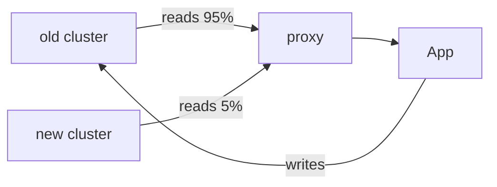

# API migration plan

We move reads first, then writes. The proxy layer stays until **every service
reads from the new cluster**, so a rollback at any point is a config flip.

## Steps

| Step | Change | Owner |
|------|--------|-------|
| 1 | Cut 5% of read traffic to the new cluster | infra |
| 2 | Raise to 50%, watch p99 for a week | infra |
| 3 | Move the remaining readers, one service at a time | each team |
| 4 | Flip writes behind a feature flag | infra |
| 5 | Retire the proxy layer | infra |

## Rollout diagram

## Cutover window

Saturday 02:00–04:00 UTC. The analytics reader migrates in step 3, before any
write traffic moves.
