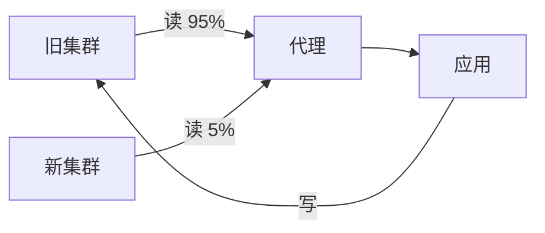

# API 迁移方案

先迁读，再迁写。在**所有服务都从新集群读取**之前，代理层保留，
任何时刻回滚都只是改一次配置。

## 步骤

| 步骤 | 改动 | 负责 |
|------|------|------|
| 1 | 先切 5% 读流量到新集群 | 基础设施 |
| 2 | 提到 50%，观察一周 p99 | 基础设施 |
| 3 | 逐个服务迁移剩余读方 | 各团队 |
| 4 | 功能开关后面切写 | 基础设施 |
| 5 | 下线代理层 | 基础设施 |

## 发布示意图

## 切换窗口

周六 02:00–04:00 UTC。分析服务的读库在第 3 步迁移，早于任何写流量切换。
