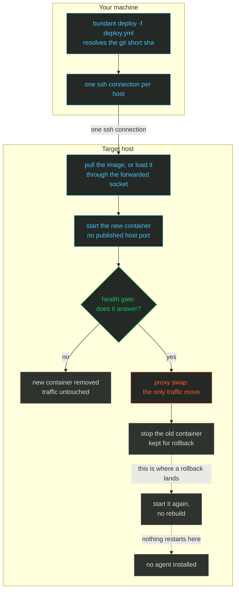

import { CardGrid, FileTree, LinkCard, Steps, Tabs, TabItem } from '@astrojs/starlight/components';

# Quick start

**What you get:** the `bundant` command installed, one host checked over ssh, and one service
running behind a proxy.

Three terms, used everywhere after this page:

- **revision** — the git short sha of the directory holding `deploy.yml`. Containers are named after it, and rollback targets it.
- **health gate** — a probe the new container must answer before traffic moves.
- **proxy swap** — the one step that points the proxy at the new container; before it, nothing user-visible changes.

<Steps>

<ol>
<li>

## Install the CLI 📦

`bundant` is not on npm yet, so install it from a checkout. This builds the Node bundle and
links the command into Bun's global bin directory.

<Tabs>
<TabItem label="From a checkout (recommended)">

```sh
git clone https://github.com/gjuoun/bundant.git
cd bundant
bun install
bun run build
bun link
bundant --version
```

</TabItem>
<TabItem label="Run from source with Bun">

`bundant-bun` executes the TypeScript sources directly, so it needs no build step:

```sh
git clone https://github.com/gjuoun/bundant.git
cd bundant
bun install
bun link
bundant-bun --version
```

</TabItem>
</Tabs>

You should see `bundant v0.1.0`.

</li>
<li>

## Write a deploy.yml 📝

`deploy.yml` is the one file that describes a service: which image to run, which hosts run it,
and how HTTP traffic reaches it. It starts with `version: 2`. Create a directory, write the
file, and commit it:

The directory holds one file:

<FileTree>
- ~/bundant-tutorial/
  - app/
    - deploy.yml
</FileTree>

```sh
mkdir -p ~/bundant-tutorial/app
cd ~/bundant-tutorial/app
git init

cat > deploy.yml <<'YAML'
version: 2
service: hello
image: traefik/whoami:v1.10
hosts: [root@box.example.com]
proxy:
  enabled: true
  host: hello.bundant.test
  port: 80
YAML

git add deploy.yml
git commit -m 'first service'
git rev-parse --short HEAD
```

The short sha is the **revision** — the commit-derived identity of this deploy. Ours was
`11a45b2`; yours will differ.

</li>
<li>

## Check the host 🖥️

`bundant runtime` asks the host which container engine it has, over the same ssh connection a
deploy uses. It changes nothing:

```sh
bundant runtime -f deploy.yml
```

```text
root@box.example.com engine=docker version=29.1.3 api=1.52 socket=/var/run/docker.sock service=active
  forward=~/.cache/bundant/forward/fwd-20078-1-mvh77n88.sock
```

</li>
<li>

## Validate, then deploy 🚀

`bundant validate` parses the file and prints the identity a deploy would use. It never opens
an ssh connection:

```sh
bundant validate -f deploy.yml
```

```text
bundant validate: OK
  version: 2
  group: default
  service: hello
  role: web
  revision: 11a45b2 (git short sha of ~/bundant-tutorial/app)
  container: default.hello.web.11a45b2
  proxy id: default.hello.web
  env path: ~/.bundant/env/default/hello-web.env
  lock key: default/hello
  round-trip: ok
```

Your revision will differ: it is the short git sha of your commit. Paths are shortened to `~`
here; the CLI prints them absolute.

Now deploy:

```sh
bundant deploy -f deploy.yml
```

```text
deploy hello/web rev=11a45b2 -> root@box.example.com
[root@box.example.com] deploying default.hello.web.11a45b2
[root@box.example.com] pull skipped (present, policy=missing)
[root@box.example.com] network ok
[root@box.example.com] run ok: default.hello.web.11a45b2
[root@box.example.com] health gate passed (1 target(s))
[root@box.example.com] proxy-ensure ok
[root@box.example.com] proxy-swap ok
[root@box.example.com] stop-old ok
deployed default.hello.web.11a45b2 on 1 host(s)
```

The deploy is a fixed sequence. In the diagram, everything in the first box happens on your
machine; everything under **Target host** happens over one ssh connection, and traffic moves at
exactly one point — the proxy swap.



*Colour legend: blue = an action on your machine or a normal step · green = healthy or live · orange = the one irreversible step · purple = storage and state.*

The container publishes no host port. **The proxy** is the shared `kamal-proxy` container on the
host: it owns port 80 and forwards each request by the `Host` header. It reaches the container by
name, and the header picks the service:

```sh
curl -s -H 'Host: hello.bundant.test' http://box.example.com/
```

```text
Hostname: 0f7eb9562aa9
IP: 127.0.0.1
IP: ::1
```

</li>
<li>

## Read the state back 📊

```sh
bundant status '*' -f deploy.yml
```

```text
default.hello.web rev=11a45b2 live=1/1 [default.hello.web.11a45b2]
```

`bundant status '*'` asks for every unit on every host; the `-f` form above narrows it to the
service in this file. `live=1/1` means one container is running and the file asks for one: the
value before the slash is what is running now, the value after it is what `deploy.yml` expects.

Output here is trimmed to what matters. Container ids, timestamps, `Up 2 seconds` and column widths
differ on every run and on every machine; the lines that carry meaning do not.

You should see `deployed default.hello.web.11a45b2 on 1 host(s)` followed by `live=1/1` — one
running container, serving through the proxy.

</li>
</ol>

</Steps>

## What actually happens ⚙️

`deploy` validates locally, takes a per-service `mkdir` lock on the first host
(`~/.bundant/locks/default/hello.lock`, reclaimed after `BUNDANT_LOCK_TTL_S`), then drives the
engine over an ssh-forwarded socket: `/images/load` (or a registry pull),
`POST /containers/create`, `POST /containers/{id}/start`, and finally
`POST /containers/{id}/stop` for the old one. The health gate is a throwaway curl sidecar on the
`bundant` network; the swap is `kamal-proxy deploy --target <container>:<port> --host <host>`
inside the proxy container, which blocks until old connections drain. The full call sequence is
in [Architecture](/bundant/docs/architecture/).

<CardGrid>
<LinkCard title="Chapter 2 — Your first service" href="/bundant/docs/tutorial/02-first-service/" description="Understand deploy.yml by editing it, validate it, then deploy it." />
<LinkCard title="deploy.yml reference" href="/bundant/docs/deploy-yml/" description="Every field in the file this chapter writes." />
</CardGrid>
