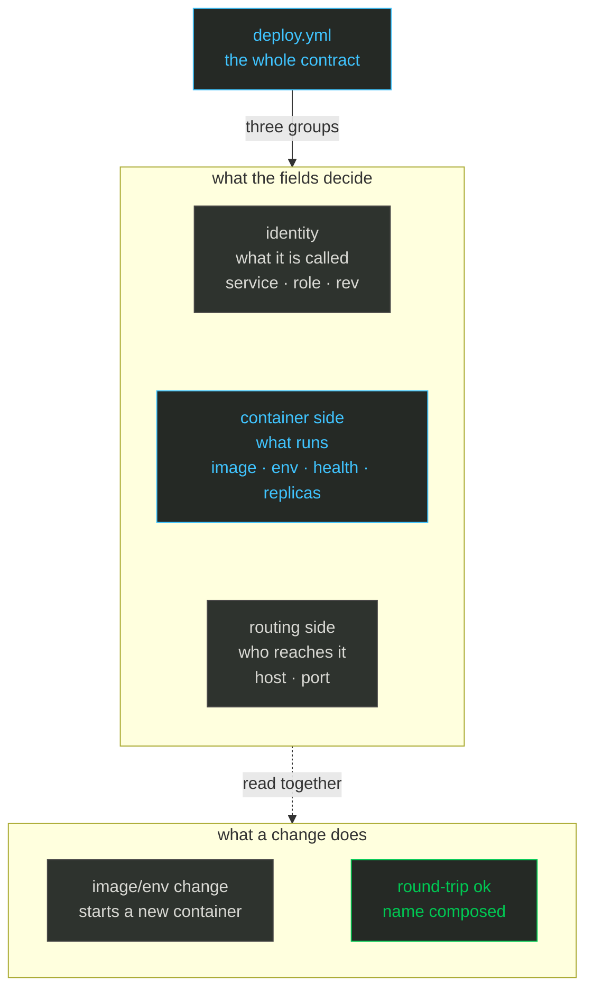

import { CardGrid, FileTree, LinkCard, Steps } from '@astrojs/starlight/components';

# Your first service

**What you get:** every line of `deploy.yml` read, a change validated, and the deploy that follows.

<Steps>

<ol>
<li>

## The file, field by field 📝

This is the complete file from the quick start, with a role, an environment variable and an
explicit health check added. The app directory still holds that one file:

<FileTree>
- ~/bundant-tutorial/
  - app/
    - deploy.yml
</FileTree>

```yaml
version: 2
service: hello                 # identifier: letters, digits, - or _
role: web                      # defaults to web
image: traefik/whoami:v1.10    # the host pulls this, or --local-image streams it
hosts: [root@box.example.com]  # user@host:port forms are allowed
env:
  vars:
    BUNDANT_DEMO: "1"          # merged into the container environment, never printed
healthcheck:
  path: /                      # probed by a throwaway sidecar before traffic moves
  timeout: 30
proxy:
  enabled: true
  host: hello.bundant.test     # Host header that selects this service
  port: 80                     # port the proxy targets
```

The mind map groups the fields by what they change. **Container side** decides what process runs;
**routing side** decides which HTTP requests reach it; identity and placement decide where it runs
and what it is called.



*Colour legend: blue = an action on your machine or a normal step · green = healthy or live · orange = the one irreversible step · purple = storage and state.*

| field | what it decides |
|---|---|
| `service` / `role` | the name: `<group>.<service>.<role>.<revision>`; `role` is a segment for variants of one service, default `web` |
| `image` | what to run; no registry is required when you use `--local-image` |
| `hosts` | one or more ssh targets; `BUNDANT_HOSTS` overrides the list |
| `env` | environment variables (name/value pairs passed into the container); values never appear in output |
| `healthcheck` | the gate that must pass before the proxy points at the new container |
| `proxy` | `enabled: false` for workers; when enabled, `host` is required |

The value of `proxy.host` is the **route host**: the `Host:` header a request must carry for the
proxy to route it to this service. Two services on one host are told apart by that header, not by
a port.

Commit the edit. The new git short sha is the new revision:

```sh
git add deploy.yml
git commit -m 'add health, env and role'
```

</li>
<li>

## Validate before you deploy ✅

```sh
bundant validate -f deploy.yml
```

```text
bundant validate: OK
  version: 2
  group: default
  service: hello
  role: web
  revision: 0f2c8cc (git short sha of ~/bundant-tutorial/app)
  container: default.hello.web.0f2c8cc
  proxy id: default.hello.web
  env path: ~/.bundant/env/default/hello-web.env
  lock key: default/hello
  round-trip: ok
```

The default output prints the identity a deploy would use. `--json` adds one JSON object on
stdout with the same identity:

```sh
bundant validate -f deploy.yml --json
```

```json
{
  "ok": true,
  "version": 2,
  "versionExplicit": true,
  "notes": [],
  "errors": [],
  "identity": { "kind": "service", "group": "default", "service": "hello" }
}
```

Validation parses the file, checks every field and the composed name, and prints the identity a
deploy would use. It does not open an ssh connection and does not take the lock.

</li>
<li>

## Deploy 🚀

```sh
bundant deploy -f deploy.yml
```

```text
deploy hello/web rev=0f2c8cc -> root@box.example.com
[root@box.example.com] deploying default.hello.web.0f2c8cc
[root@box.example.com] pull skipped (present, policy=missing)
[root@box.example.com] network ok
[root@box.example.com] run ok: default.hello.web.0f2c8cc
[root@box.example.com] health gate passed (1 target(s))
[root@box.example.com] proxy-ensure ok
[root@box.example.com] proxy-swap ok
[root@box.example.com] stop-old ok
deployed default.hello.web.0f2c8cc on 1 host(s)
```

On a host with only sshd, `bundant bootstrap` installs podman and enables its socket first; the
same phases then run over the podman endpoint instead of the docker one.

What the phases mean:

- **pull** — the host already had the image, so this was a no-op. Without a registry,
  `--local-image` streams it over the same ssh connection.
- **network** — the shared `bundant` network exists.
- **run** — the new container starts with `--restart unless-stopped`; it publishes no host port.
- **health gate** — a throwaway sidecar requests `healthcheck.path`; a failure aborts before
  traffic moves.
- **proxy-ensure / proxy-swap** — the proxy container is running, then its target set is swapped
  in one call and old connections drain.
- **stop-old** — the previous revision is stopped, not removed; it is the rollback material.

```sh
bundant history -f deploy.yml
```

```text
== root@box.example.com (hello-web) ==
 * default.hello.web.0f2c8cc 1 replica    Up                       2026-10-20 21:31:44 +0000 UTC
   default.hello.web.11a45b2 1 replica    Exited (2) Less than a second ago 2026-10-20 21:31:42 +0000 UTC
  * = running revision
```

`bundant history -f deploy.yml` shows every retained revision and marks the running one with
`*`.

You should see `health gate passed` followed by `proxy-swap ok` and
`deployed ... on 1 host(s)`; `history` marks the new revision with `*` and keeps the old one
stopped.

</li>
</ol>

</Steps>

## What actually happens ⚙️

Validate runs the same zod preflight that every mutating command runs — before it creates an ssh
executor or takes the lock — so an invalid file causes zero host contact. Deploy then builds a
typed `ContainerSpec` (image, merged env, labels `bundant.kind`/`bundant.revision`/
`bundant.replica`) and posts it to `/containers/create`; `healthcheck.port` defaults to
`proxy.port`. The proxy route id is stable across revisions: `<group>.<service>.<role>`. See
[Validation](/bundant/docs/validation/), the
[deploy.yml reference](/bundant/docs/deploy-yml/) and
[Architecture](/bundant/docs/architecture/).

<CardGrid>
<LinkCard title="Chapter 3 — Operate" href="/bundant/docs/tutorial/03-operate/" description="The day-two loop: status, logs, revisions and rollback." />
<LinkCard title="deploy.yml reference" href="/bundant/docs/deploy-yml/" description="Every field, its default and what changing it does." />
</CardGrid>

