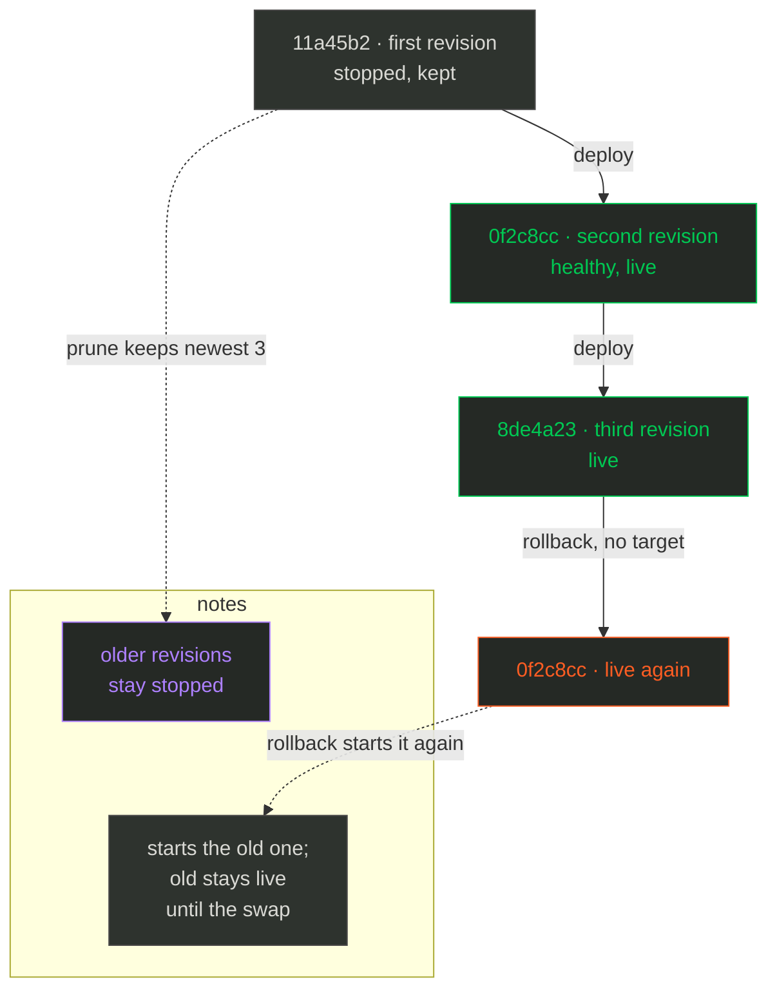

import { CardGrid, LinkCard, Steps } from '@astrojs/starlight/components';

# Operate

**What you get:** the running state read back, the logs, and the previous revision restored.

<Steps>

<ol>
<li>

## Ship a second revision 🚀

Change one value in the complete `deploy.yml` from chapter 2:

```yaml
version: 2
service: hello
role: web
image: traefik/whoami:v1.10
hosts: [root@box.example.com]
env:
  vars:
    BUNDANT_DEMO: "2"
healthcheck:
  path: /
  timeout: 30
proxy:
  enabled: true
  host: hello.bundant.test
  port: 80
```

Every commit is a revision, because the revision is the git short sha of the directory holding
`deploy.yml`. Commit and deploy:

```sh
git add deploy.yml
git commit -m 'change the demo env'
bundant deploy -f deploy.yml
```

```text
deploy hello/web rev=8de4a23 -> root@box.example.com
[root@box.example.com] deploying default.hello.web.8de4a23
[root@box.example.com] pull skipped (present, policy=missing)
[root@box.example.com] network ok
[root@box.example.com] run ok: default.hello.web.8de4a23
[root@box.example.com] health gate passed (1 target(s))
[root@box.example.com] proxy-ensure ok
[root@box.example.com] proxy-swap ok
[root@box.example.com] stop-old ok
deployed default.hello.web.8de4a23 on 1 host(s)
```

</li>
<li>

## Read it back 📊

A **unit** is one addressable thing bundant manages — a service or an accessory — and a
**selector** is the path you pass to a flat verb: `group.service.role` for a service,
`group.service` for an accessory, matched as a glob where `*` is one segment and `**` is any
number.

`bundant status '*' -f deploy.yml` prints one line per unit:

```sh
bundant status '*' -f deploy.yml
```

```text
default.hello.web rev=8de4a23 live=1/1 [default.hello.web.8de4a23]
```

`--json` prints the same unit fields as one object:

```sh
bundant status '*' -f deploy.yml --json
```

```json
{"ok":true,"command":"status","data":[{"path":"default.hello.web","live":1}]}
```

```sh
bundant logs '*' -f deploy.yml --tail 5
```

```text
default.hello.web.8de4a23 | 2026/10/20 21:31:47 Starting up on port 80
```

Each line is prefixed with the container it came from, which matters once a service has more than
one copy (a **replica**, covered in chapter 4). `bundant history` lists every retained revision,
newest first — the timestamps and the `Up`/`Exited` ages are from the run that produced this page,
so yours will show different ones:

```sh
bundant history -f deploy.yml
```

```text
== root@box.example.com (hello-web) ==
 * default.hello.web.8de4a23 1 replica    Up                       2026-10-20 21:31:47 +0000 UTC
   default.hello.web.0f2c8cc 1 replica    Exited (2) 1 second ago  2026-10-20 21:31:44 +0000 UTC
   default.hello.web.11a45b2 1 replica    Exited (2) 3 seconds ago 2026-10-20 21:31:42 +0000 UTC
  * = running revision
```

</li>
<li>

## Roll back ⏪

**Rollback** means starting a retained revision and pointing the proxy back at it. `bundant
rollback` with no target goes to the previous revision: it starts the old container, runs the same
health gate, swaps the proxy, and stops the current one:

```sh
bundant rollback -f deploy.yml
```

```text
[root@box.example.com] rollback: default.hello.web.8de4a23 -> default.hello.web.0f2c8cc (1 replica(s) as deployed)
[root@box.example.com] health gate passed on default.hello.web.0f2c8cc
[root@box.example.com] rolled back to default.hello.web.0f2c8cc (1 replica(s))
```

With no target, rollback always goes to the previous revision, so you do not need the sha for the
common case. Use `--to-revision <sha>` only when you want an older one.

```sh
bundant status '*' -f deploy.yml
```

```text
default.hello.web rev=0f2c8cc live=1/1 [default.hello.web.0f2c8cc]
```

```sh
bundant history -f deploy.yml
```

```text
== root@box.example.com (hello-web) ==
   default.hello.web.8de4a23 1 replica    Exited (2) Less than a second ago 2026-10-20 21:31:47 +0000 UTC
 * default.hello.web.0f2c8cc 1 replica    Up                       2026-10-20 21:31:44 +0000 UTC
   default.hello.web.11a45b2 1 replica    Exited (2) 6 seconds ago 2026-10-20 21:31:42 +0000 UTC
```

The timeline is the point of the design: the old container is stopped, never removed, so rollback
is a **start**, not a rebuild. The stopped revisions wait until `bundant prune` keeps the newest
`--keep` (default 3) and removes the rest.



*Colour legend: blue = an action on your machine or a normal step · green = healthy or live · orange = the one irreversible step · purple = storage and state.*

To pick an exact revision, use `bundant rollback --to-revision <sha> -f deploy.yml`. A revision
is retained until `bundant prune` removes it or you delete the service. `--to-revision` starts any
retained revision, including one older than the current schema or data migration: the container
goes back, its volumes do not, so check what the old revision expects before you point traffic at
it.

You should see `rolled back to default.hello.web.0f2c8cc` and, in `status`, the revision
after `rev=` change from `8de4a23` back to `0f2c8cc`.

</li>
</ol>

</Steps>

## What actually happens ⚙️

`deploy` takes a per-service `mkdir` **lock** on the first host — `~/.bundant/locks/default/hello.lock`,
holding an owner line and reclaimed after `BUNDANT_LOCK_TTL_S` — so two deploys cannot interleave.
Each container carries `bundant.revision` and `bundant.replica` labels; `status`, `history`,
`scale` and `rollback` read those labels rather than a local file. `rollback` selects the
previous revision (or `--to-revision`), starts the stopped container, re-runs the health gate, does
one proxy deploy, then stops the revision that was live. Commands and exit codes are in the
[CLI reference](/bundant/docs/cli/); the sequence is in
[Architecture](/bundant/docs/architecture/).

<CardGrid>
<LinkCard title="Chapter 4 — Scale and groups" href="/bundant/docs/tutorial/04-scale-and-groups/" description="Run several replicas, then deploy a group with a stateful accessory." />
<LinkCard title="CLI reference" href="/bundant/docs/cli/" description="Every command, flag, selector and exit code used on this page." />
</CardGrid>
