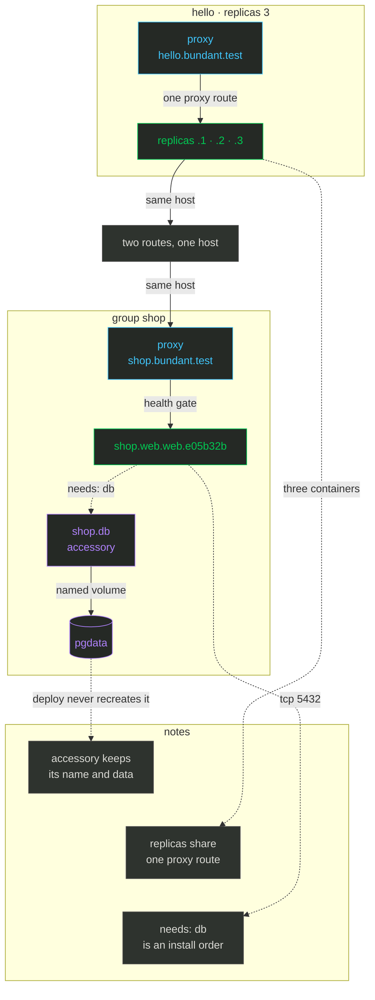

import { CardGrid, FileTree, LinkCard, Steps } from '@astrojs/starlight/components';

# Scale and groups

**What you get:** several copies of one service behind the proxy, and a group whose web service
waits for a stateful database before it starts.

Three terms carry this chapter. A **replica** is one of N copies of the same revision on a host:
`replicas: 3` names them `.1`, `.2`, `.3` and the proxy balances across all of them. An
**accessory** is a stateful group member (a database, a queue) with a stable name, named volumes
(a volume is storage that outlives the container), no revision, no proxy, and never recreated by a
deploy. A **group** is a directory with a `group.yml` that lists members and their `needs` edges;
the install order is the topological sort of those edges.

<Steps>

<ol>
<li>

## More than one replica 📈

This is the complete `deploy.yml` with `replicas: 3` added. Commit it and deploy:

```yaml
version: 2
service: hello
role: web
image: traefik/whoami:v1.10
hosts: [root@box.example.com]
replicas: 3
env:
  vars:
    BUNDANT_DEMO: "2"
healthcheck:
  path: /
  timeout: 30
proxy:
  enabled: true
  host: hello.bundant.test
  port: 80
```

```sh
git add deploy.yml
git commit -m 'run three replicas'
bundant deploy -f deploy.yml
```

```text
deploy hello/web rev=7db591d -> root@box.example.com
[root@box.example.com] deploying default.hello.web.7db591d.1, default.hello.web.7db591d.2, default.hello.web.7db591d.3
[root@box.example.com] pull skipped (present, policy=missing)
[root@box.example.com] network ok
[root@box.example.com] run ok: default.hello.web.7db591d.1, default.hello.web.7db591d.2, default.hello.web.7db591d.3
[root@box.example.com] health gate passed (3 target(s))
[root@box.example.com] proxy-ensure ok
[root@box.example.com] proxy-swap ok
[root@box.example.com] stop-old ok
deployed default.hello.web.7db591d.1, default.hello.web.7db591d.2, default.hello.web.7db591d.3 on 1 host(s)
```

```sh
bundant status '*' -f deploy.yml
```

```text
default.hello.web rev=7db591d live=3/3 [default.hello.web.7db591d.3, default.hello.web.7db591d.2, default.hello.web.7db591d.1]
```

`scale` changes the running revision without a deploy. It never pulls an image and never edits
your file. Scale up to 5:

```sh
bundant scale --replicas 5 -f deploy.yml
```

```text
== root@box.example.com ==
  revision 7db591d: 3 running (1, 2, 3) -> 5
  run ok (default.hello.web.7db591d.4, default.hello.web.7db591d.5)
  health ok (2 target(s))
  proxy-swap ok
  scaled to 5 replica(s)
bundant: scale is temporary - deploy.yml replicas: stays authoritative; the next `bundant deploy` re-applies it.
```

`deploy.yml` still says 3, so after the scale up `status` shows the drift:

```sh
bundant status '*' -f deploy.yml
```

```text
default.hello.web rev=7db591d live=5/3 [default.hello.web.7db591d.5, default.hello.web.7db591d.4, default.hello.web.7db591d.3, default.hello.web.7db591d.2, default.hello.web.7db591d.1]
```

`live=5/3` means five containers are running while the file still asks for three. Scale back down
with `bundant scale --replicas 3 -f deploy.yml`; the proxy loses the two targets before the
containers stop, so no in-flight request is cut off:

```sh
bundant scale --replicas 3 -f deploy.yml
```

```text
== root@box.example.com ==
  revision 7db591d: 5 running (1, 2, 3, 4, 5) -> 3
  proxy-swap ok
  stop-old ok (default.hello.web.7db591d.4, default.hello.web.7db591d.5)
  scaled to 3 replica(s)
bundant: scale is temporary - deploy.yml replicas: stays authoritative; the next `bundant deploy` re-applies it.
```

The topology below shows both shapes: three replicas behind one proxy route, and a group whose
web member depends on an accessory that owns a volume.



*Colour legend: blue = an action on your machine or a normal step · green = healthy or live · orange = the one irreversible step · purple = storage and state.*

</li>
<li>

## A group with an accessory 🧩

A group is a directory. `shop/group.yml` lists the members; each member has its own complete file:

<FileTree>
- ~/bundant-tutorial/
  - app/
    - deploy.yml
    - shop/
      - group.yml
      - db/
        - accessory.yml
      - web/
        - deploy.yml
</FileTree>

```yaml
# shop/group.yml
version: 2
group: shop
services:
  - name: db
    file: ./db/accessory.yml
  - name: web
    file: ./web/deploy.yml
    needs: [db]
```

The database is an accessory: no revision, no proxy, a stable name and a named volume.

```yaml
# shop/db/accessory.yml
version: 2
kind: accessory
service: db
image: docker.io/library/postgres:16-alpine
hosts: [root@box.example.com]
env:
  vars:
    POSTGRES_DB: shop
    POSTGRES_USER: shop
    POSTGRES_PASSWORD: tutorial
volumes:
  - "pgdata:/var/lib/postgresql/data"
healthcheck:
  tcp: 5432
  timeout: 60
proxy:
  enabled: false
```

`shop/web/deploy.yml` is a normal service file. It names the service `web` and routes to
`shop.bundant.test`:

```yaml
# shop/web/deploy.yml
version: 2
service: web
image: traefik/whoami:v1.10
hosts: [root@box.example.com]
healthcheck:
  path: /
  timeout: 30
proxy:
  enabled: true
  host: shop.bundant.test
  port: 80
```

Validate the group, then install it:

```sh
bundant validate -f shop/group.yml
```

```text
bundant validate: OK
  version: 2
  group: shop
  revision: e05b32b (git short sha of ~/bundant-tutorial/app/shop)
  order: db -> web
  member db: shop.db round-trip=true
  member web: shop.web.web.e05b32b round-trip=true
```

`group install` deliberately refuses to create the database for you:

```sh
bundant group install -f shop/group.yml
```

```text
bundant group install - shop rev=e05b32b order=db -> web
  shop.db: absent on root@box.example.com
bundant: accessory 'db' is not ready - start it first:
  bundant start -f ~/bundant-tutorial/app/shop/db/accessory.yml
group install report: applied [] failed [db] skipped [db, web]
```

Start it explicitly, then install the group again:

```sh
bundant start -f shop/db/accessory.yml
bundant group install -f shop/group.yml
```

```text
bundant accessory boot - shop.db on root@box.example.com (image docker.io/library/postgres:16-alpine, runtime docker)
== root@box.example.com ==
  container shop.db started
  tcp readiness ok on :5432
booted shop.db on 1 host(s)
bundant group install - shop rev=e05b32b order=db -> web
  shop.db: ready (tcp:5432) on root@box.example.com
deploy web/web rev=e05b32b -> root@box.example.com
[root@box.example.com] deploying shop.web.web.e05b32b
[root@box.example.com] pull skipped (present, policy=missing)
[root@box.example.com] network ok
[root@box.example.com] run ok: shop.web.web.e05b32b
[root@box.example.com] health gate passed (1 target(s))
[root@box.example.com] proxy-ensure ok
[root@box.example.com] proxy-swap ok
[root@box.example.com] stop-old ok
deployed shop.web.web.e05b32b on 1 host(s)
group install report: applied [db, web]
```

```sh
bundant group status -f shop/group.yml | grep -E '===|volumes:|replicas:|revision:|health'
curl -s -H 'Host: shop.bundant.test' http://box.example.com/
```

```text
=== shop/db (accessory) ===
  volumes: pgdata
=== shop/web (service) ===
  replicas: live 1 / expected 1
  revision: shop.web.web.e05b32b
  health(shop.web.web.e05b32b): HTTP 200
Hostname: 7f047f6dcc1a
IP: 127.0.0.1
IP: ::1
```

You should see `order: db -> web` from validation and `group install report: applied [db, web]`
after the accessory is running. `needs: [db]` is why web waits for the TCP probe on 5432.

</li>
</ol>

</Steps>

## What actually happens ⚙️

Each replica is a separate container named `<group>.<service>.<role>.<rev>.<i>` and labelled
`bundant.replica=<i>`, all carrying the same `bundant.revision`. Deploy gates each one, then makes
**one** proxy call with the full target set. Scaling down reverses the safety order: proxy first
(drain), then stop and remove. A group install takes one group lock, then each service's own lock;
an accessory dependency is checked by a bare TCP connect from a throwaway busybox sidecar on the
`bundant` network. The rules are in the
[deploy.yml reference](/bundant/docs/deploy-yml/#replicas), including
[group.yml](/bundant/docs/deploy-yml/#groupyml) and
[accessory.yml](/bundant/docs/deploy-yml/#accessoryyml).

<CardGrid>
<LinkCard title="Chapter 5 — Observe and debug" href="/bundant/docs/tutorial/05-observe/" description="Inspect the host, read events, open the UI and diagnose a failed deploy." />
<LinkCard title="deploy.yml reference: replicas and groups" href="/bundant/docs/deploy-yml/#replicas" description="The replica, group.yml and accessory.yml rules this chapter applies." />
</CardGrid>
