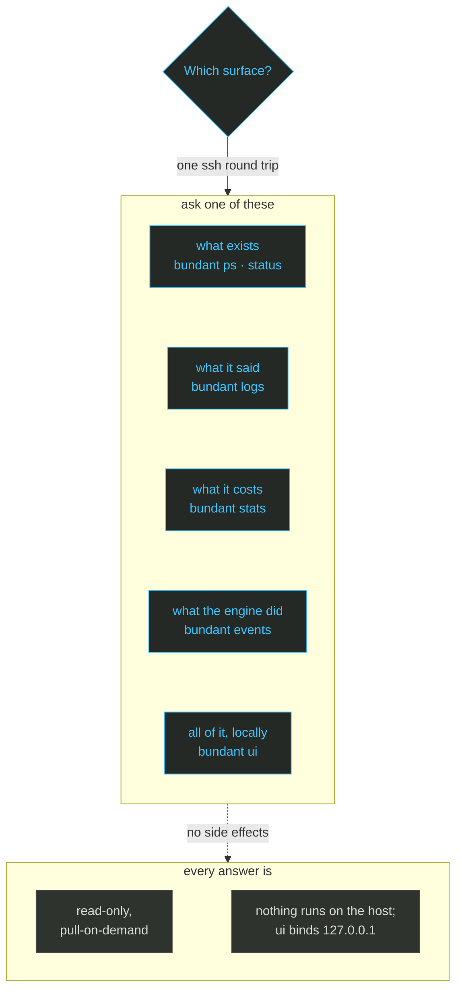

import { CardGrid, LinkCard, Steps } from '@astrojs/starlight/components';

# Observe and debug

**What you get:** what every host is running, what it said, what it cost, the same view in a local
UI, and the reason a deploy failed.

Flat verbs address containers by the **unit path** from chapter 3: `group.service.role` for a
service and `group.service` for an accessory, matched as a glob (`*` is everything, `shop.**`
is the group). That path is the selector; revision and replica are flags (`--revision`,
`--replica`), never path segments.

<Steps>

<ol>
<li>

## Look at the host 🔍

All monitoring is read-only and pull-on-demand: one ssh round trip per host, nothing installed
there. The diagram maps the question to the surface that answers it.



*Colour legend: blue = an action on your machine or a normal step · green = healthy or live · orange = the one irreversible step · purple = storage and state.*

The columns are name, image, status and ports. Widths depend on your terminal, so the spacing below
will not match exactly:

```sh
bundant ps -f deploy.yml | grep -E 'hello|shop|kamal'
```

```text
  shop.web.web.e05b32b         traefik/whoami:v1.10                   Up 2 seconds               80/tcp
  shop.db                      docker.io/library/postgres:16-alpine   Up 8 seconds               5432/tcp
  default.hello.web.7db591d.3  traefik/whoami:v1.10                   Up 16 seconds              80/tcp
  default.hello.web.7db591d.2  traefik/whoami:v1.10                   Up 17 seconds              80/tcp
  default.hello.web.7db591d.1  traefik/whoami:v1.10                   Up 17 seconds              80/tcp
  default.hello.web.8de4a23    traefik/whoami:v1.10                   Exited (2) 19 seconds ago
  default.hello.web.0f2c8cc    traefik/whoami:v1.10                   Exited (2) 15 seconds ago
  default.hello.web.11a45b2    traefik/whoami:v1.10                   Exited (2) 24 seconds ago
  kamal-proxy                  docker.io/basecamp/kamal-proxy:latest  Up 2 days                  0.0.0.0:80->80/tcp, :::80->80/tcp, 0.0.0.0:443->443/tcp, :::443->443/tcp
```

The stopped `hello` revisions are the rollback material from chapter 3; only the three
`7db591d` copies are live.

```sh
bundant stats '*' -f deploy.yml | sed -n '1,8p'
bundant events --since 5m -f deploy.yml | sed -n '1,8p'
```

```text
== root@box.example.com ==
  shop.web.web.e05b32b         0.00%  1.90MiB / 8.00GiB   0.02%  5
  shop.db                      0.00%  66.88MiB / 8.00GiB  0.82%  6
  default.hello.web.7db591d.3  0.00%  2.12MiB / 8.00GiB   0.03%  5
  default.hello.web.7db591d.2  0.00%  2.15MiB / 8.00GiB   0.03%  5
  default.hello.web.7db591d.1  0.00%  2.19MiB / 8.00GiB   0.03%  5
== root@box.example.com ==
  1792531917|container|start|default.hello.web.7db591d.5
  1792531917|container|create|bundant-probe-jya-1
  1792531917|network|connect|bundant
  1792531917|container|start|bundant-probe-jya-1
  1792531918|network|disconnect|bundant
  1792531918|container|die|bundant-probe-jya-1
  1792531918|container|destroy|bundant-probe-jya-1
```

`inspect` reads one container's state. `exec` runs a command inside a unit; everything after
`--` is passed through untouched:

```sh
bundant inspect '*' -f deploy.yml
bundant exec 'shop.db' -f shop/db/accessory.yml -- hostname
```

```text
== root@box.example.com ==
  name          shop.web.web.e05b32b
  state         running
  restarts      0  exitCode=0
  started       2026-10-20T21:32:08.00961349Z
  image         traefik/whoami:v1.10
  restart policy unless-stopped  log driver=json-file
ceb403c30372
```

When a deploy misbehaves, `bundant events --since 5m -f deploy.yml` shows what the engine did —
create, start, die, destroy — in the order it did it. It is the shortest path from "it is down" to
the step that failed.

</li>
<li>

## The local UI 🖥️

`bundant ui` serves one read-only page from your machine. It binds `127.0.0.1` by default, so
the host exposes no new port:

```sh
bundant ui --port 8787 -f deploy.yml
```

```text
bundant ui - http://127.0.0.1:8787
  hosts: root@box.example.com
  read-only, pull-on-demand: every query is one ssh round trip per host; nothing runs on them
  remote access: ssh -L 8787:127.0.0.1:8787 <host> (or tailscale)
```

It returns `200` on `http://127.0.0.1:8787/`; the containers, stats, logs, proxy and events
tabs fill in as the page polls.

</li>
<li>

## Diagnose a failed deploy ⚠️

A config can be valid and still fail on the host. This complete file asks the health gate to probe
a port nothing listens on:

```yaml
# broken/deploy.yml
version: 2
service: broken
image: traefik/whoami:v1.10
hosts: [root@box.example.com]
healthcheck:
  path: /
  port: 59999
  timeout: 5
proxy:
  enabled: false
```

```sh
bundant deploy -f broken/deploy.yml
```

```text
deploy broken/web rev=e05b32b -> root@box.example.com
[root@box.example.com] deploying default.broken.web.e05b32b
[root@box.example.com] pull skipped (present, policy=missing)
[root@box.example.com] network ok
[root@box.example.com] run ok: default.broken.web.e05b32b
[root@box.example.com] aborted, removed containers started by this run (default.broken.web.e05b32b)
bundant: health gate failed: GET http://default.broken.web.e05b32b:59999/ never returned 200 (last: curl: (7) Failed to connect to default.broken.web.e05b32b port 59999 after 0 ms: Could not connect to server
000)
```

The failed container is gone, and the previous revision kept serving:

```sh
bundant ps -f broken/deploy.yml | grep broken || echo 'no broken container left'
```

```text
no broken container left
```

</li>
<li>

## When the host has nothing 📦

On a host with only sshd, `bundant bootstrap` installs podman, configures the registry search
path, enables the restart unit and runs a smoke container. Every step is idempotent. The complete
file used below:

```yaml
# hello-podman.yml
version: 2
service: hello-podman
image: traefik/whoami:v1.10
runtime: podman
hosts: [root@box.example.com]
proxy: { enabled: true, host: hello-podman.bundant.test, port: 80 }
```

```sh
bundant bootstrap -f hello-podman.yml
```

```text
  - podman API socket
    podman.socket already enabled and active
  - podman version
    podman version 5.7.0
  - smoke test (pull + run)
    smoke test passed
  engine: podman 5.7.0  socket: /run/podman/podman.sock  service: enabled
  ready
```

On a docker host there is nothing to bootstrap: the engine is already installed and running. Check
it with `bundant runtime -f deploy.yml` (chapter 1), which reports the engine, API version and
socket.

You should see `health gate failed` with the probe URL for a broken health check,
`no broken container left` afterwards, and `ready` from bootstrap. The deploy that failed
never swapped the proxy, so the previous revision keeps serving.

</li>
</ol>

</Steps>

## What actually happens ⚙️

Each read verb resolves the selector against container labels, opens one multiplexed ssh
connection per host, and calls the engine API through the forwarded socket:
`/containers/json` for `ps`, `/containers/{id}/logs` for `logs`, `/containers/{id}/stats`
for `stats`, `/containers/{id}/json` for `inspect`, `/events?since=…` for `events`, and
`/containers/{id}/exec` for `exec`. `events` is bounded by `timeout 3` so it always returns a
window instead of following forever. `bundant ui` is a local read-only HTTP server on
`127.0.0.1:8787`; each tab triggers the same ssh calls, and nothing is installed on the host.
The retention limits and the full surface are in [Monitoring](/bundant/docs/monitoring/).

<CardGrid>
<LinkCard title="deploy.yml reference" href="/bundant/docs/deploy-yml/" description="The file behind every surface on this page." />
<LinkCard title="Architecture" href="/bundant/docs/architecture/" description="The call sequence behind ps, logs, stats, events and deploy." />
</CardGrid>
